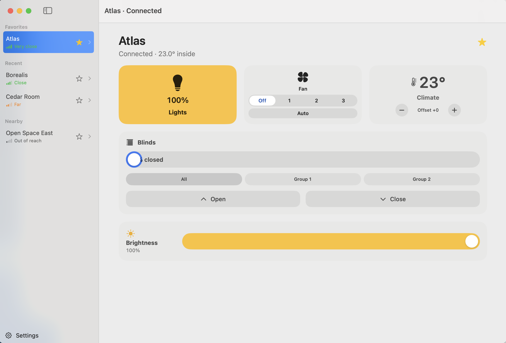

# Personify Desk

An unofficial Mac app for the room controls in a Distech / Acuity **my PERSONIFY** Bluetooth room: lights, setpoint offset, fan, and blind groups.

It is not affiliated with Distech Controls or Acuity Brands.

## Features

- Sidebar of rooms in range, grouped as Favorites, Recent, and Nearby
- Favorites are only the rooms you star, stored by the name the room advertises
- The last room you open is selected again at launch when it is still in range
- Signal bars labeled by distance: Very close, Close, Far, Out of reach
- Lights, brightness, climate offset, fan, and blind groups
- A room can have anywhere from one to eight blind groups
- A pairing code is asked for only when pairing fails, and it is saved on this Mac

## Requirements

- macOS 14 or later
- Swift 6.4
- Xcode is not required. The Swift 6.4 Command Line Tools are enough.

## Build

```bash
make test
make app
```

`make test` runs the Swift test suite. `make app` builds `dist/PersonifyDesk.app` and signs it ad-hoc (`codesign --sign -`). Set `CODESIGN_IDENTITY` to sign with an existing identity instead.

## Screenshots

Sample rooms, with Bluetooth left off:



Regenerate that image on a Mac:

```bash
bash scripts/screenshots.sh
```

The script launches the app with `--demo` (or `PERSONIFY_DEMO=1`) and saves the window with `screencapture`.

## Disclaimer

Personify Desk is an independent project. It is not affiliated with, endorsed by, or supported by Distech Controls or Acuity Brands. my PERSONIFY, Distech, Acuity, Allure, ECLYPSE, and nLight are names of their respective owners.

Built with Grok Bot.
